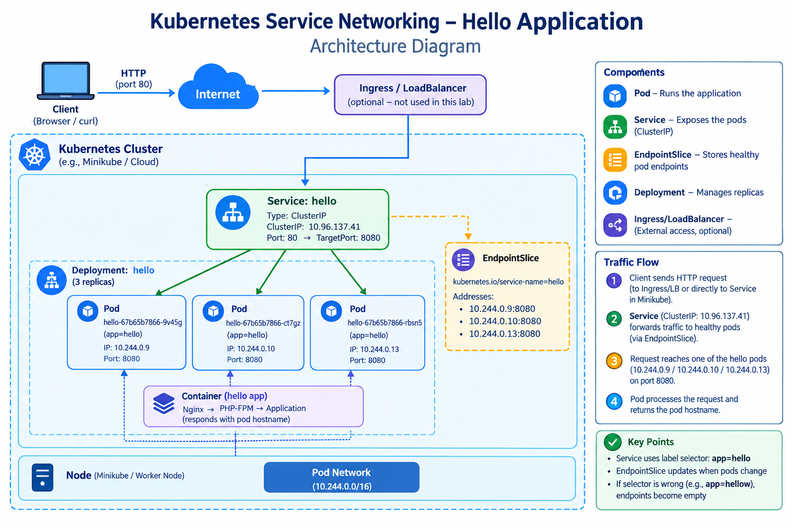

# Day 17 — Kubernetes Services & Networking

Part of my 90 Days DevOps Winter Arc.

## Objective

Learn Kubernetes ClusterIP Services, service discovery through
DNS, EndpointSlices, backend traffic, Pod replacement, and
selector troubleshooting using an existing local kind cluster.

## Architecture



## Technologies

- Kubernetes
- kind
- kubectl
- BusyBox
- CoreDNS
- ClusterIP Service
- EndpointSlices

## Repository Structure

```text
day17-services/
├── svc-clusterip.yaml
├── README.md
├── architecture.png
└── Screenshots/
    ├── service-endpoints.png
    ├── dns-load-balancing.png
    ├── pod-replacement.png
    ├── selector-recovery.png
    └── selector-failure-fix.png
```

## 1. Create the Workload

```bash
kubectl create deployment hello --replicas=3 \
  --image=registry.k8s.io/e2e-test-images/agnhost:2.39 \
  -- /agnhost netexec --http-port=8080
```

Wait for the replicas:

```bash
kubectl rollout status deployment/hello --timeout=180s
kubectl get pods -l app=hello --show-labels
```

## 2. Create the ClusterIP Service

```bash
kubectl expose deployment hello --name=hello \
  --type=ClusterIP --port=80 --target-port=8080
```

The Service manifest is available in `svc-clusterip.yaml`.

## 3. Inspect the Service and EndpointSlices

```bash
kubectl get svc hello -o wide
kubectl describe svc hello
kubectl get endpointslices \
  -l kubernetes.io/service-name=hello -o wide
```

## 4. Test Service DNS and HTTP

Start a temporary client:

```bash
kubectl run tmp --rm -it --image=busybox:1.36 \
  --restart=Never -- sh
```

Inside the client:

```sh
nslookup hello
nslookup hello.default.svc.cluster.local

for i in 1 2 3 4 5 6; do
  wget -qO- http://hello/hostname
  echo
done
```

## 5. Observe Pod Replacement

Delete one Pod selected from the actual workload:

```bash
kubectl get pods -l app=hello
kubectl delete pod POD_NAME
kubectl get pods -l app=hello -w
```

After the replacement becomes ready:

```bash
kubectl get endpointslices \
  -l kubernetes.io/service-name=hello -o wide
```

## 6. Break and Fix the Selector

Introduce a selector mismatch:

```bash
kubectl patch service hello \
  -p '{"spec":{"selector":{"app":"hellow"}}}'
```

Inspect the result:

```bash
kubectl describe svc hello
kubectl get endpointslices \
  -l kubernetes.io/service-name=hello -o wide
```

Restore the selector:

```bash
kubectl patch service hello \
  -p '{"spec":{"selector":{"app":"hello"}}}'
```

Verify endpoint recovery and repeat the HTTP test.

## Key Concepts

- **Service:** Stable access point for an application.
- **ClusterIP:** Internal virtual IP for the Service.
- **Selector:** Matches Pods by their labels.
- **EndpointSlice:** Records backend network endpoints associated
  with a Service.
- **CoreDNS:** Resolves Kubernetes Service DNS names.
- **port:** Port exposed by the Service.
- **targetPort:** Port used by the backend application.
- **Pod replacement:** A Deployment maintains the desired replica count.

## Troubleshooting

If endpoints are missing, compare the Service selector with
the Pod labels and check readiness.

If DNS works but HTTP fails, check EndpointSlices, the target
port, and whether the application is listening.

Repeated requests do not guarantee perfectly even traffic
distribution across all replicas.

## Evidence

Screenshots are stored in the `evidence/` directory.

- Service and endpoint inspection
- DNS lookup and HTTP requests
- Pod replacement
- Selector failure and recovery

Evidence should reflect the actual commands and results
from my own local cluster.

## Cleanup

```bash
kubectl delete service hello
kubectl delete deployment hello
```

Only remove resources created for this assignment.
